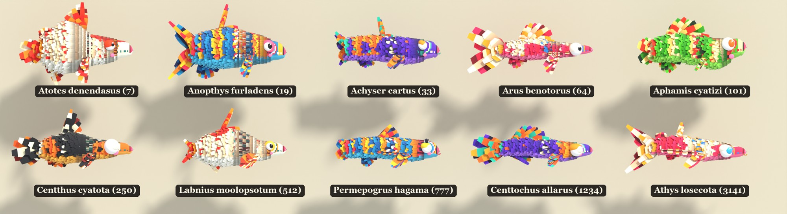
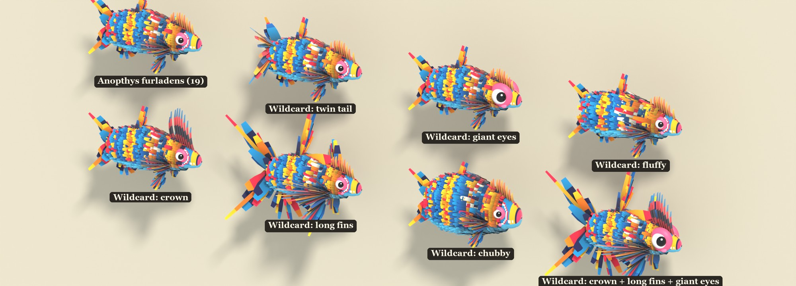
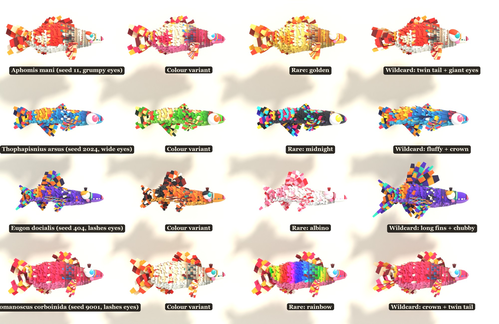

# pinata-fish

Endless paper piñata fish. Each fish starts as a procedural drawing from
[fishdraw](https://github.com/LingDong-/fishdraw) and is rebuilt in Blender as a 3D creature made of
overlapping paper scraps, with colour variants, rare variants and wildcards.



One design, with odd traits added one at a time:



Each design in four versions (common, colour variant, rare, wildcard):



This is a work in progress, published as it stands. The look is inspired by the paper animals of
*Viva Piñata*; this project is not affiliated with that game or its owners, and contains none of its assets.

## How it works

1. `tools/fishdraw_export.mjs` runs fishdraw for a seed and saves the fish as plain shape data: the side
   outline, every fin outline and the eye (`art/pinata/fishdraw/fish_<seed>.json`). Thirty are included.
2. `tools/build_pinata_fish.py` runs in Blender. It turns that outline into a rounded body, covers it in
   strips of paper scraps, roots a fan of paper streamers at each fin, picks a face from the seed, and
   renders a sheet.
3. `tools/label_sheet.py` writes each fish's name under it.

More on the paper look in [docs/HOW_THE_PAPER_WORKS.md](docs/HOW_THE_PAPER_WORKS.md).

## Run it

Needs Blender (built with 5.1), Node.js, and Python with Pillow for the labels.

```
git clone https://github.com/LingDong-/fishdraw          # into this folder, for new seeds only
node tools/fishdraw_export.mjs 11 2024 404 9001
blender --background --python tools/build_pinata_fish.py -- 11 2024 404 9001 --mode grid --out my_sheet
python tools/label_sheet.py my_sheet
```

Sheets are written to `art/pinata/fishdraw/`.

| Option | What it does |
|---|---|
| `--mode commons` | One of each seed in its own colours (the default) |
| `--mode grid` | Each seed as common, colour variant, rare and wildcard |
| `--mode wildcards` | One seed: common, then each odd trait alone, then two stacked |
| `--samples N` | Render quality (default 64) |
| `--cols N` | Fish per row in `commons` mode |

Rare variants: golden, midnight, albino, rainbow. Wildcard traits: twin tail, giant eyes, fluffy, crown,
long fins, chubby.

## What is not here yet

- The fish are render-only. Nothing exports a game-ready model.
- `tools/pinata_skin.py` (a painted skin with shells and edge fringe, used for other creatures) is included
  but the fish do not use it yet.
- `tools/build_pinata_koi.py` is the first hand-tuned koi the generator grew out of; the generator imports
  its strip-building code. Its own koi render needs files that are not in this repository.

## Credits and licence

MIT; see [LICENSE](LICENSE). Fish shapes come from [fishdraw](https://github.com/LingDong-/fishdraw) by
Lingdong Huang, also MIT ([its licence](docs/FISHDRAW_LICENSE)). fishdraw itself is not copied into this
repository.
