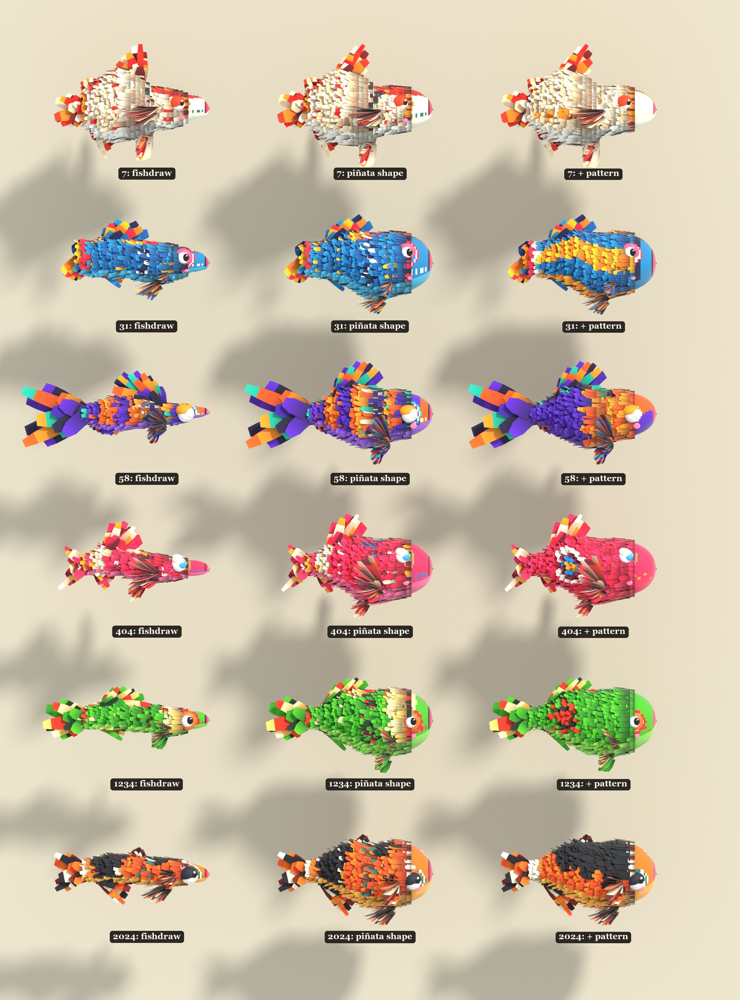
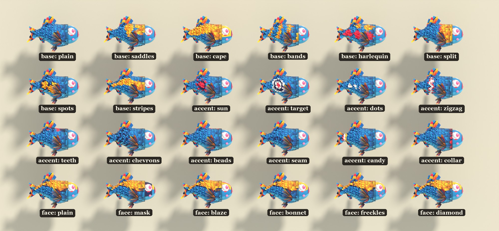
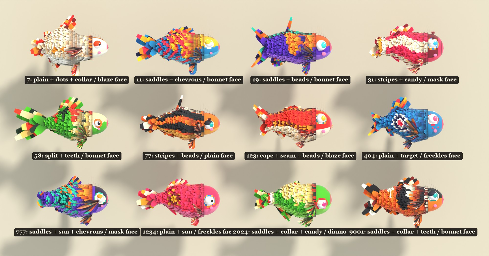

# Piñata shape and coat patterns

How a fishdraw design becomes a chunky paper piñata, and the set of coat patterns it can wear. The look is
inspired by paper piñata animals in general. Every pattern here is our own, built from the folk-art set in
[HOW_THE_PAPER_WORKS.md](HOW_THE_PAPER_WORKS.md).

Code: `PinataShape` and `remap` in `tools/build_pinata_fish.py`, and everything in `tools/pinata_patterns.py`. Use them through
`build(..., form="pinata", coat="auto")`.

## The piñata shape



fishdraw draws fish the way a naturalist would: long, thin, and with a pointed snout. A piñata wants a toy
silhouette, so `PinataShape` reworks the outline:

| Step | What it does | Why |
|---|---|---|
| Smooth | Four passes of a small blur over height and mid-line | fishdraw's outline is hand-wobbly; paper wants clean curves |
| Fill out | half-height = (h / h_max)^0.55 × 0.21 of length | Thin designs gain the most, so every fish ends up chunky but keeps its own profile |
| Big head | +16% around t = 0.2 | Piñata animals are head-heavy |
| Belly | The underside drops up to 30% more than the back rises, around t = 0.46 | A hanging belly reads as cute; a symmetric body reads as a torpedo |
| Teardrop | Full to halfway, then easing (1 - g^1.6) into the tail stock | Without it the body stops like a can at the tail |
| Flat mid-line | The mid-line is pulled halfway to its mean | Takes out fishdraw's arching |
| Round section | Width is 0.92 of height (fishdraw's is 0.8) | Nearly round, like a paper-covered balloon |
| Long nose cap | The head rounds off over the first 26% instead of 14% | A face, not a snout or a can lid |
| Painted face | Fringe starts at t = 0.25 instead of 0.17; eyes come forward to t = 0.17 | A big smooth head to paint on, with the eyes on it rather than under the streamers |

`remap` moves fishdraw's fins and eye onto the new body. A point inside the old outline keeps its relative
place across the body, and a point outside keeps its distance from the outline, so the fins keep their size.

## Coat patterns



A recipe is **one base layout, at most two accents and a face**. Patterns return a *role*, not a colour:
body, mark, gold, teal, deep, belly, pink or white. The palette turns each role into a colour, so one recipe
works in every colourway, rare and wildcard.

Patterns are drawn in painter's coordinates: the fish seen from the side with its flank unrolled. `x` runs
along the body in body units, `y` runs up the flank from the lateral line, and `up` runs from -1 under the
belly to 1 on the ridge. Both flanks get the same picture.

### Bases (cover the whole body)

| Name | Looks like |
|---|---|
| plain | Body colour only; it lets an accent carry the fish |
| saddles | 2–3 big patches thrown over the back, reaching part-way down the flanks |
| cape | Countershading: mark colour on the back down to a wavy line, often stitched along it |
| bands | Upright ribbons round the body, bowed and leaning, sometimes stitched |
| harlequin | Big diamonds in two colours, every third one gold |
| split | Front half one colour, back half the other, meeting along a zigzag |
| spots | 3–5 big round spots, often outlined |
| stripes | 2–3 long waved stripes from nose to tail |

### Accents (painted over the base)

| Name | Looks like | Notes |
|---|---|---|
| sun | Gold disc, deep ring, 8 gold rays | Flank, behind the pectoral fan (t ≈ 0.6) |
| target | Gold, teal, deep and white rings | Flank, same place |
| dots | A row of big dots along the lateral line | Back half only |
| zigzag | Teal band with gold edges, round the body | |
| teeth | Gold and deep triangles standing along the back | |
| chevrons | Gold arrowheads pointing at the nose | Tail half |
| beads | Alternating beads down the ridge | |
| seam | A stitched gold and deep line along the lateral line | |
| candy | Rings round the root of the tail | |
| collar | Alternating blocks where the fringe starts | |

### Faces (painted on the smooth head)

Every face has pink lips, white patches round the eyes and, on most fish, teal and gold eye rings. Then one of:
plain, mask (a dark band across the eyes), blaze (a gold stripe from nose to brow), bonnet (the top of
the head in the mark colour), freckles (gold dots under the eyes) or diamond (a brow diamond).

## Rules the code keeps

- **Bold and few.** One base and at most two accents. `Recipe.from_seed` drops flank accents (sun, target,
  dots) on busy bases, and drops zigzag and chevrons on bands and harlequin.
- **Several scraps wide.** A scrap is about 0.11 × 0.14 body units. Anything narrower than about two scraps
  disappears; the first seam and beads were one scrap wide and could not be seen.
- **Clear of the fins.** The pectoral fans cover the front half of the flank, so flank accents sit behind them.
- **Curved borders, stitched.** Region edges wave, and some get a row of stitches beside them.

## Recipes for the dozen



`Recipe.from_seed(seed)` picks a recipe. To force one:

```python
from pinata_patterns import Recipe
r = Recipe("cape", ["sun", "beads"], face="mask")          # parameters drawn from seed 0
r = Recipe("bands", [("zigzag", {"at": 0.65})], face="blaze", seed=4)
build(404, 0, origin, form="pinata", coat=r)
```

To add a pattern, write a function `(params, x, y, up, t, row, k) -> role or None`, add it to `BASES` or
`ACCENTS` (with defaults in `base_params` or `accent_params`), and check it on the catalogue sheet:

```
blender --background --python tools/pattern_sheet.py -- patterns 404
python tools/label_sheet.py patterns
```
